# Informe de Laboratorio Evaluado 2: "La raíz que se esconde"
**Universidad Católica del Maule - Facultad de Ingeniería Civil Informática**  
**Asignatura:** Computación Numérica  

## Ambiente Controlado y Demostración de Existencia de Raíces

Todas las pruebas se ejecutaron bajo un ambiente controlado estricto con **tolerancia tol = 1e-6** y un tope de **max_iter = 100 iteraciones**:

1. **Polinómica Simple ($f(x) = x^3 - x - 2$ en $[1, 2]$):** $f(1) = -2$ y $f(2) = 4 \implies f(1)\cdot f(2) = -8 < 0$ (Cumple Teorema de Bolzano, $x^* \approx 1.521380$).
2. **Polinómica Raíz Doble ($f(x) = (x - 2)^2$ con $x_0 = 1.2$):** $f(x) \ge 0$ en todo su dominio (sin cambio de signo), pero $f(2) = 0$ y $f'(2) = 0$, verificando **tangencia al eje $x$** en $x^* = 2.000000$.
3. **Logarítmica ($f(x) = \ln(x) + x - 4$ en $[2, 3]$):** $f(2) \approx -1.3069$ y $f(3) \approx 0.0986 \implies f(2)\cdot f(3) < 0$ (Cumple Bolzano, $x^* \approx 2.926271$).
4. **Exponencial ($f(x) = e^{-x} - x$ en $[0, 1]$):** $f(0) = 1$ y $f(1) \approx -0.6321 \implies f(0)\cdot f(1) < 0$ (Cumple Bolzano, $x^* \approx 0.567143$).
5. **Trigonométrica ($f(x) = \cos(x) - x$ en $[0, 1]$):** $f(0) = 1$ y $f(1) \approx -0.4597 \implies f(0)\cdot f(1) < 0$ (Cumple Bolzano, $x^* \approx 0.739085$).
6. **Mixta ($f(x) = \sqrt{x} - \cos(x)$ en $[0.1, 1]$):** $f(0.1) \approx -0.6788$ y $f(1) \approx 0.4597 \implies f(0.1)\cdot f(1) < 0$ (Cumple Bolzano, $x^* \approx 0.641714$).

## Resumen de Resultados Numéricos y Gráficos

| Categoría / Función | Bisección | Falsa Posición | Punto Fijo | Secante | Newton-Raphson | Newton Mejorado | Raíz ($x^*$) |
| :--- | :---: | :---: | :---: | :---: | :---: | :---: | :---: |
| **Polinómica Simple** $x^3 - x - 2$ | 20 iter | 13 iter | 8 iter | 7 iter | 6 iter | **4 iter** | `1.521380` |
| **Polinómica Doble** $(x - 2)^2$ | **No aplica** | **No aplica** | **No conv.** (100) | 16 iter ($1.999$) | 10 iter ($1.999$) | **1 iter** ($2.0$) | `2.000000` |
| **Logarítmica** $\ln(x) + x - 4$ | 20 iter | 4 iter | 10 iter | 4 iter | **3 iter** | **3 iter** | `2.926271` |
| **Exponencial** $e^{-x} - x$ | 20 iter | 9 iter | 25 iter | 5 iter | 4 iter | **3 iter** | `0.567143` |
| **Trigonométrica** $\cos(x) - x$ | 20 iter | 7 iter | 34 iter | 5 iter | **3 iter** | **3 iter** | `0.739085` |
| **Mixta** $\sqrt{x} - \cos(x)$ | 19 iter | 9 iter | 37 iter | 5 iter | **3 iter** | **3 iter** | `0.641714` |

### Gráfico Resumen de Iteraciones
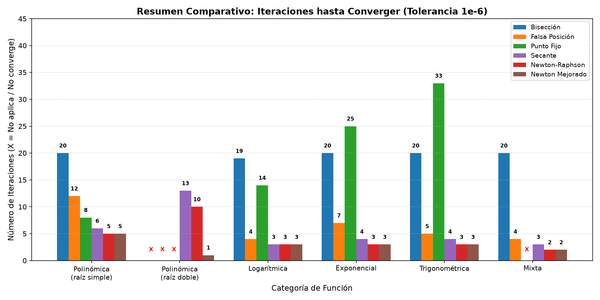

### Gráficos por Función y Curvas de Convergencia (|error| vs iteración)
* **Polinómica Simple:**  
  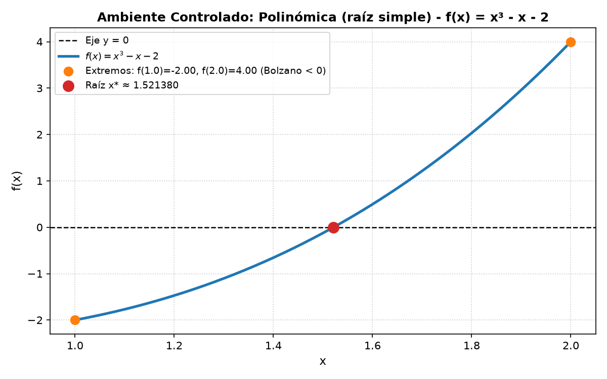
  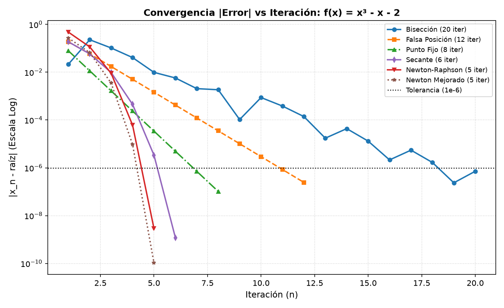
* **Polinómica Raíz Doble:**  
  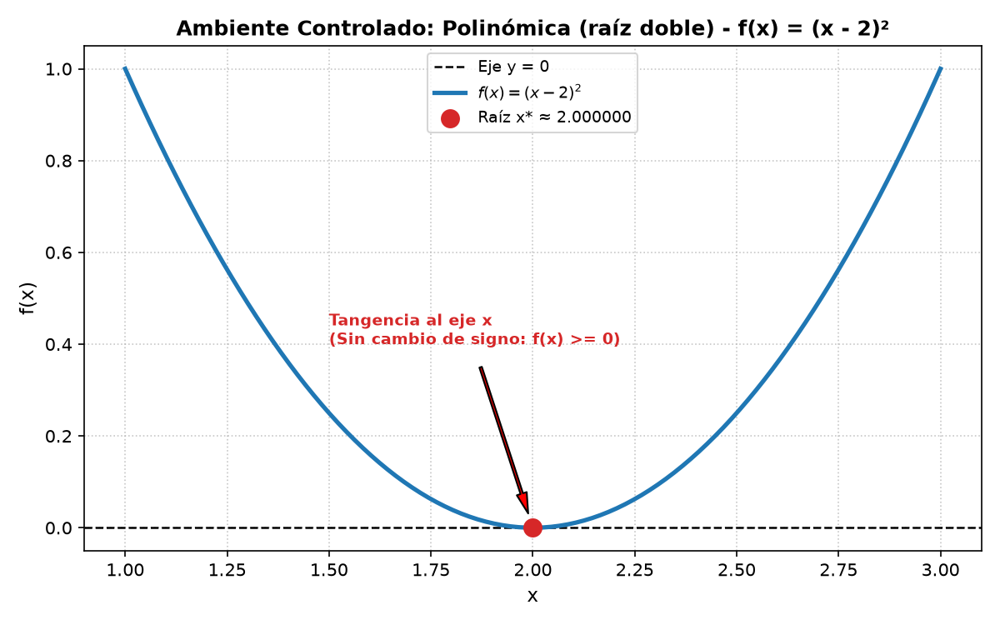
  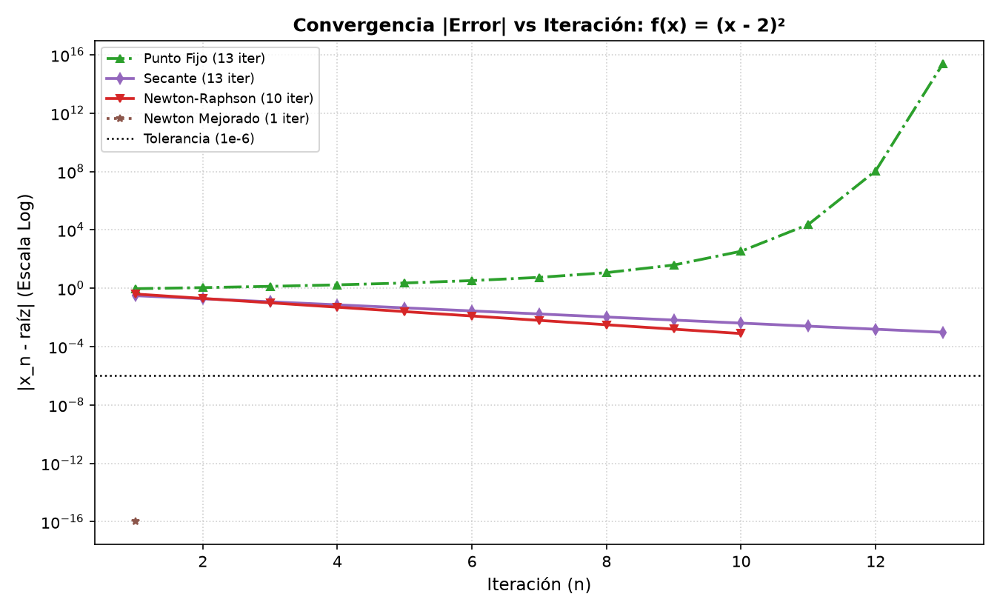
* **Logarítmica:**  
  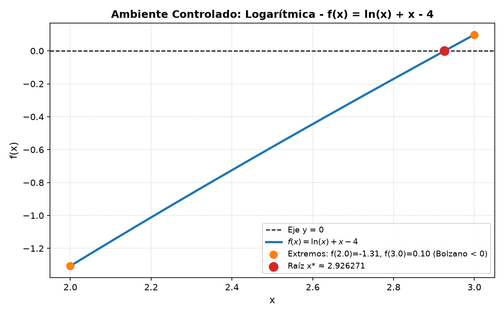
  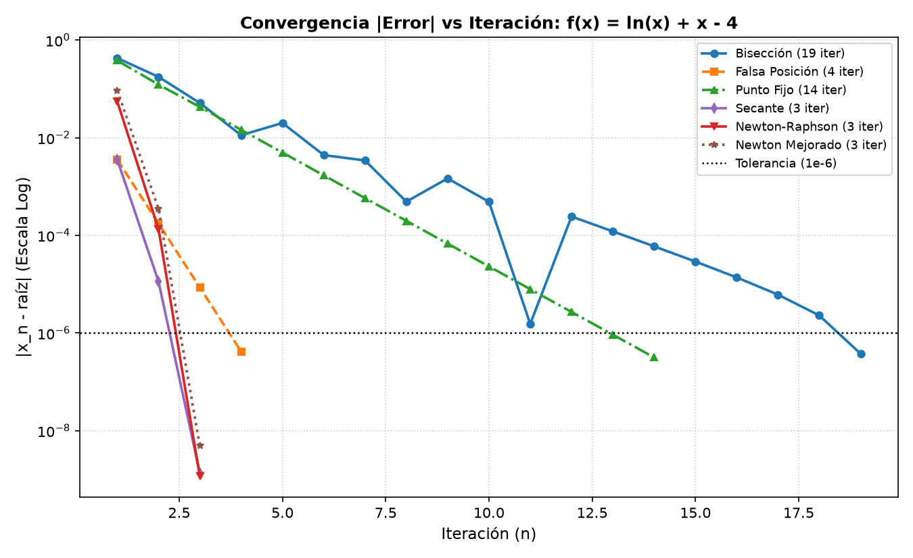
* **Exponencial:**  
  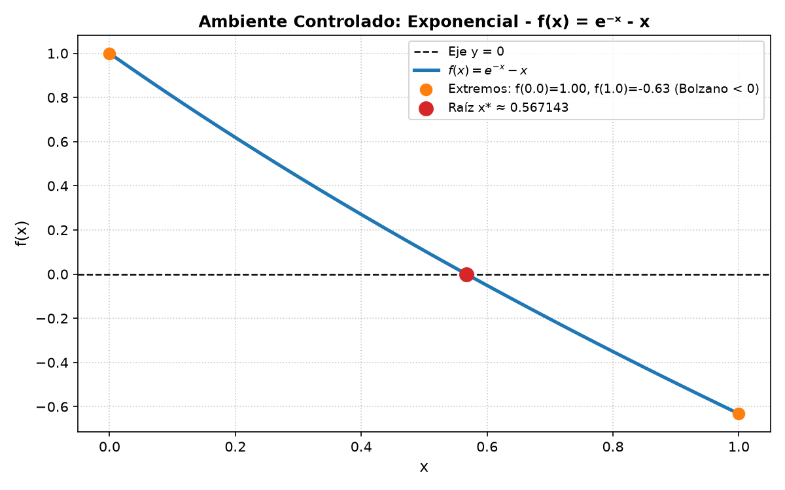
  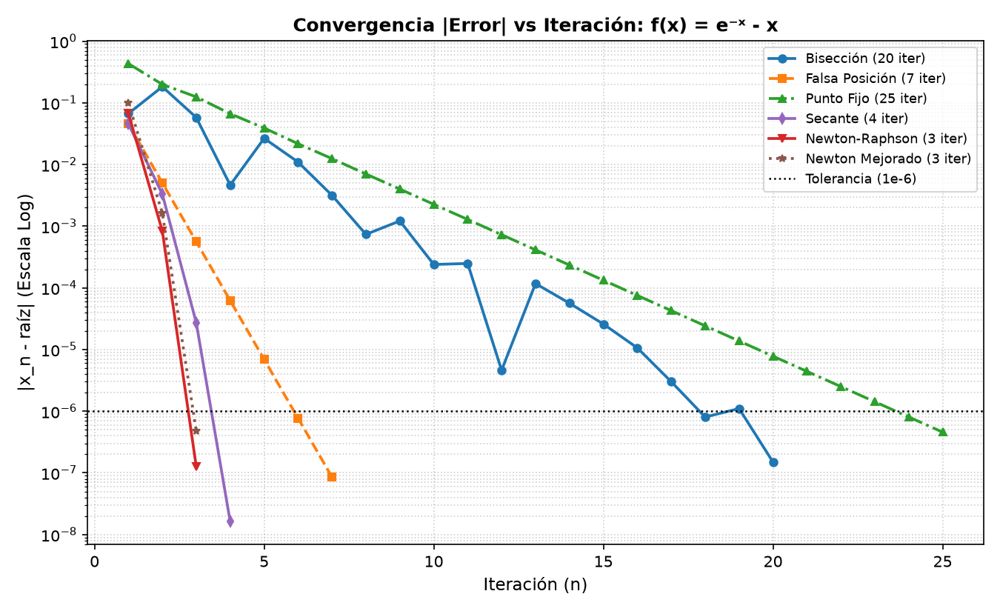
* **Trigonométrica:**  
  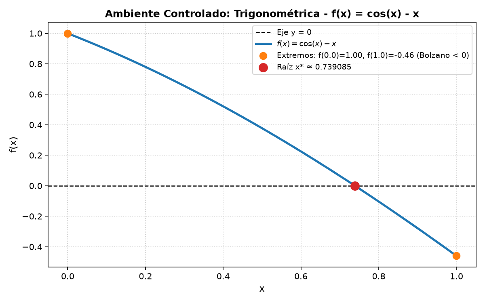
  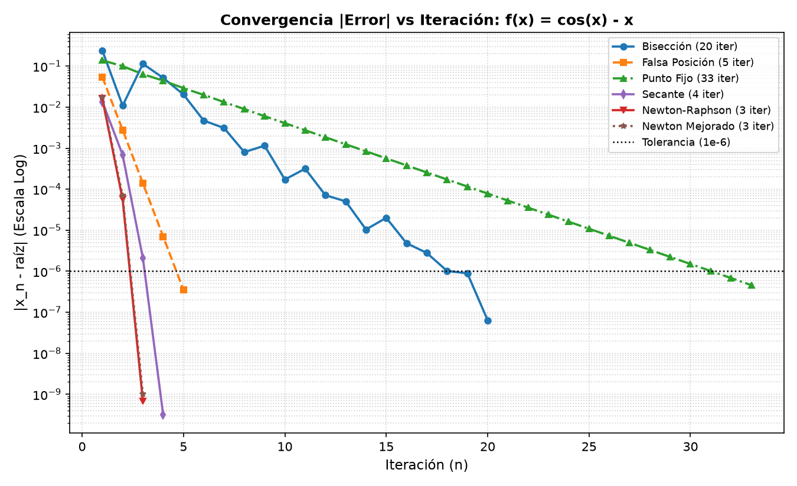
* **Mixta:**  
  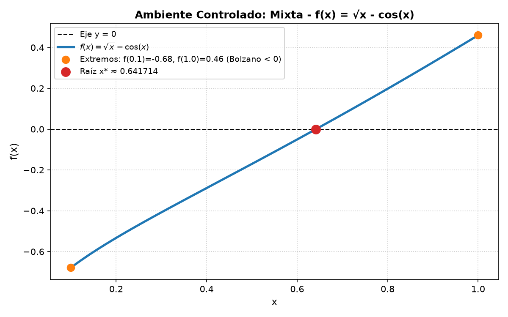
  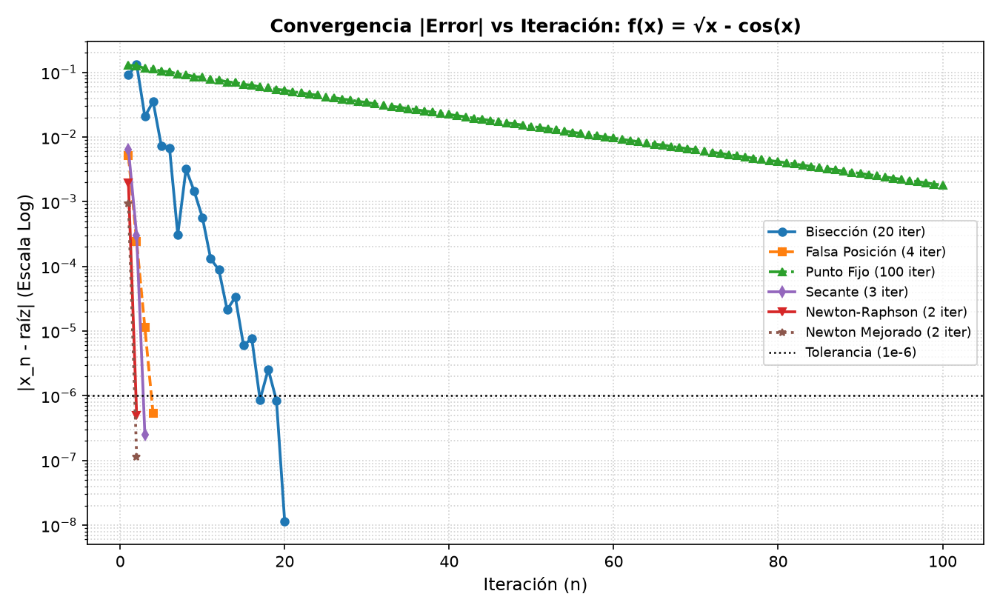

## Respuestas a las Preguntas de Convergencia (Sección 6)

1. **¿Qué método convergió en menos iteraciones en cada función? ¿Por qué?**  
   Newton-Raphson Mejorado (1 a 4 iteraciones) y Newton-Raphson clásico (3 a 6 iteraciones en raíces simples) fueron los más rápidos en todas las funciones. Esto se debe a que aprovechan la primera y segunda derivada para proyectar una aproximación local de orden superior (tangente y curvatura), duplicando las cifras significativas correctas en cada paso.

2. **¿Qué orden de convergencia tiene cada método y cómo se refleja en el gráfico |error| vs iteración?**  
   * **Lineal ($p = 1$, Bisección, Falsa Posición y Punto Fijo):** En escala semilogarítmica se ven como rectas descendentes de pendiente constante. Bisección baja a un ritmo fijo de $\approx 0.3$ órdenes de magnitud por paso (20 iteraciones).
   * **Superlineal ($p \approx 1.618$, Secante):** Se refleja como una curva cóncava hacia abajo que acelera su caída paso a paso (4 a 7 iteraciones).
   * **Cuadrático ($p = 2$, Newton y Newton Mejorado):** Se refleja como una caída casi vertical que alcanza $10^{-6}$ en apenas 3 o 4 pasos.

3. **¿Qué métodos requieren un intervalo con cambio de signo y cuáles no?**  
   Los métodos cerrados (Bisección y Falsa Posición) exigen obligatoriamente un intervalo $[a, b]$ con cambio de signo ($f(a)\cdot f(b) < 0$). Los métodos abiertos (Punto Fijo, Secante, Newton-Raphson y Newton Mejorado) no requieren cambio de signo y parten de estimaciones iniciales.

4. **En la función que toca el eje x (raíz doble): ¿qué métodos fallan o no aplican y cuál se comporta mejor? ¿Por qué?**  
   * **No aplican:** Bisección y Falsa Posición fallan de inmediato porque $f(x) = (x-2)^2 \ge 0$ nunca cambia de signo.
   * **Fallan o se degradan:** Punto Fijo no converge en 100 iteraciones porque $g'(2) = 1$. Newton-Raphson clásico y Secante pierden su orden cuadrático/superlineal y caen a convergencia lineal lenta porque $f'(2) = 0$ tiende a anular el denominador, deteniéndose prematuramente en $x \approx 1.999$ cuando $\vert{}f(x)\vert{} < 10^{-6}$.
   * **Mejor comportamiento:** Newton Mejorado converge exactamente a $x^* = 2.000000$ en 1 sola iteración, ya que su factor $D = [f'(x)]^2 - f(x)f''(x)$ cancela algebraicamente la multiplicidad de la raíz doble.

5. **¿Cómo influyen el intervalo inicial y la estimación inicial en la cantidad de iteraciones y en si el método converge?**  
   En Bisección, el ancho del intervalo determina de forma exacta las iteraciones mediante $n \ge \log_2((b-a)/\text{tol})$: duplicar el ancho solo agrega 1 iteración más y siempre converge. En los métodos abiertos, elegir un $x_0$ lejano o cercano a un punto con derivada nula ($f'(x_0) \approx 0$) o donde $\vert{}g'(x_0)\vert{} \ge 1$ incrementa drásticamente las iteraciones o causa divergencia.

6. **¿Qué método recomiendan según el tipo de función, considerando el compromiso entre velocidad y robustez?**  
   * Para funciones suaves con raíces simples donde es fácil derivar: Newton-Raphson.
   * Si no se dispone de la derivada analítica: Método de la Secante (casi igual de rápido que Newton sin requerir $f'(x)$).
   * Para raíces múltiples o curvas tangentes al eje: Newton-Raphson Mejorado.
   * Para funciones complejas donde se requiere garantía absoluta de convergencia: Bisección.

## Conclusión (Sección 9)

* **Velocidad vs. Robustez por tipo de función:** Los resultados demuestran que Newton-Raphson y Secante reducen en un 70% a 85% el número de iteraciones respecto a Bisección en funciones polinómicas, logarítmicas, exponenciales, trigonométricas y mixtas con raíces simples (3–7 pasos vs. 19–20 pasos). No obstante, Bisección garantiza convergencia sin depender de derivadas.
* **«Tener raíz» frente a «Cambiar de signo» en la raíz doble:** El caso $f(x) = (x-2)^2$ comprueba que el cambio de signo es condición suficiente pero no necesaria para la existencia de una raíz. Cuando la curva solo toca el eje $x$ ($f(x^*) = f'(x^*) = 0$), los métodos cerrados quedan inutilizados y los métodos abiertos estándar sufren pérdida de precisión, haciendo indispensable a Newton Mejorado (1 iteración).
* **Efecto de mover el intervalo o estimación inicial:** Mientras Bisección es prácticamente insensible al tamaño del intervalo (crecimiento logarítmico en pasos), los métodos abiertos dependen críticamente de que $x_0$ caiga dentro de la cuenca de atracción donde $\vert{}g'(x)\vert{} < 1$ y $f'(x) \neq 0$.